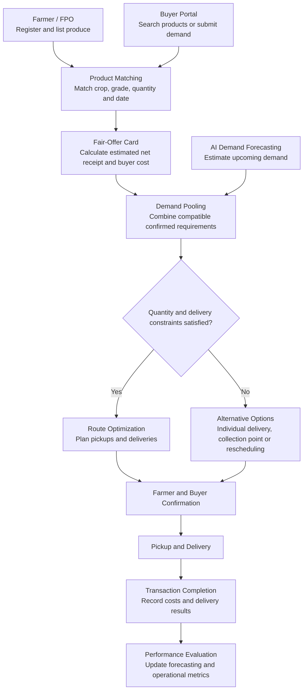

# SMART INDIA HACKATHON WORKSHOP

**Date:** 26 October 2026  
**Reference Number:** 26004251  
**Name:** Ashwin Kumaran P

---

## Problem Title

**SIH 26033: Multiple intermediaries reduce farmers' earnings and increase consumer prices.**

## Problem Creator's Organization

Ministry of Consumer Affairs, Food & Public Distribution

## Theme

Agriculture, FoodTech & Rural Development

---

## Problem Description

Agriculture is a major source of livelihood for millions of people. However, agricultural products often pass through several intermediaries before reaching consumers. Each stage may introduce additional handling, transportation, storage and trading costs, increasing the final price of the product.

At the same time, farmers may have limited access to reliable market information, distant buyers, transportation facilities and accurate demand forecasts. They may need to sell their produce quickly because of perishability, uncertain demand or storage limitations. Consumers, meanwhile, may pay significantly more than the amount received by the original producer.

The lack of coordination between farmers, buyers and transportation providers can also lead to inefficient deliveries, unsold agricultural products and avoidable wastage.

The expected solution is a digital marketplace that directly connects farmers and Farmer Producer Organisations (FPOs) with consumers and bulk buyers, provides logistics support, and uses Artificial Intelligence (AI) for demand forecasting and route optimization.

The major objectives are to improve farmers' net earnings, make agricultural products more affordable for consumers, increase supply-chain transparency and reduce avoidable operational costs.

# 1. Proposed Solution

## 1.1 Solution Overview

**HarvestLink – An AI-Assisted Farmer-to-Buyer Marketplace with Demand Pooling and Shared Logistics**

HarvestLink is a digital agricultural marketplace designed to connect farmers and Farmer Producer Organisations (FPOs) directly with households, retailers, supermarkets, restaurants, hostels, hotels, grocery stores and other bulk buyers.

The platform integrates product listing, buyer requirements, transparent price comparison, AI-assisted demand forecasting and shared transportation into a single system.

Instead of operating only as an online shop, HarvestLink coordinates the three major stages of agricultural trade:

1. **Market discovery:** Helping farmers find buyers and helping buyers discover suitable agricultural products.
2. **Demand coordination:** Combining compatible buyer requirements to create practical procurement and delivery batches.
3. **Logistics optimization:** Recommending efficient pickup and delivery arrangements based on location, quantity, vehicle capacity and delivery deadlines.

The central idea is to reduce unnecessary coordination costs and help both farmers and buyers make better-informed decisions.

## 1.2 Objectives of HarvestLink

The proposed platform has the following objectives:

- Enable direct transactions between farmers, FPOs, consumers and bulk buyers.
- Improve transparency in product prices, transportation charges and other deductions.
- Help farmers compare offers based on estimated net earnings.
- Forecast local demand to support production and dispatch planning.
- Combine compatible orders to improve transportation efficiency.
- Reduce the risk of unsold produce through advance buyer requirements.
- Provide reliable order tracking, delivery confirmation and transaction records.
- Create a scalable marketplace that can expand across crops and geographical areas.

## 1.3 Detailed Explanation of the Proposed Solution

### A. Farmer and FPO Registration

Farmers and FPOs can register on the platform using their basic details and contact information. Where appropriate, verification can be performed through an administrator or a suitable verification process.

After registration, farmers can manage their product listings through a simple dashboard.

Each product listing contains:

- Crop or product name.
- Variety and quality grade.
- Available quantity and unit of measurement.
- Expected selling price per kilogram or other unit.
- Harvest date or product-ready date.
- Pickup location.
- Availability period.
- Minimum acceptable selling price, if specified.
- Product images and relevant quality information.

Farmers can update the available quantity or price as market conditions change. The system should prevent orders from exceeding the quantity confirmed as available.

### B. Direct Buyer Connection

Consumers and bulk buyers can search for agricultural products according to crop type, price, quantity, quality, location and expected delivery date.

A household may purchase a relatively small quantity, whereas a hostel, restaurant or retailer may require a larger quantity on a regular basis.

HarvestLink supports both types of buyers by matching their requirements with suitable farmer listings.

Buyers can either:

- Purchase produce that is currently available.
- Submit a future requirement for a specified date.
- Express interest in a pooled order.
- Select an available delivery or collection option.

This allows farmers to discover demand before dispatching their products and gives regular buyers an organized way to plan procurement.

### C. Fair-Offer Card: Transparent Net-Earnings Comparison

One of the key features of HarvestLink is the **Fair-Offer Card**.

A selling price alone does not indicate how much a farmer will actually receive. Transportation, loading, handling and platform charges can reduce the final amount.

The Fair-Offer Card presents these components separately so farmers can compare available offers.

For example, consider a hypothetical transaction:

| Cost component | Example amount |
|---|---:|
| Buyer payment for produce | ₹2,000 |
| Allocated transportation cost | ₹150 |
| Handling cost | ₹50 |
| Platform fee | ₹0 |
| Estimated farmer net receipt | ₹1,800 |

These figures are illustrative and do not represent actual market prices.

The system estimates net earnings using the following formula:

**Estimated farmer net receipt = Product sale amount − Farmer-borne transportation costs − Handling costs − Applicable platform fees − Other disclosed deductions**

The platform should clearly distinguish the farmer's net receipt from profit, since production expenses may not be included in this calculation.

Buyers can also see the expected product cost and delivery charges before confirming their orders.

This feature helps users compare offers using total cost and estimated net receipt rather than headline selling price alone.

### D. Demand Pooling and Shared Logistics

Small orders can sometimes be expensive to transport individually. HarvestLink introduces a **Demand Pooling System** to identify compatible orders that can share a delivery arrangement.

For example, three farmers in the same region may list tomatoes, while two restaurants and a hostel submit purchase requirements.

The system checks:

- Whether the products meet the requested quality requirements.
- Whether the quantities are compatible.
- Whether the products will be available within the required period.
- Whether the pickup points can be combined practically.
- Whether buyers can accept a common delivery window.
- Whether vehicle capacity and handling requirements are satisfied.

When the conditions are met, the system proposes a pooled order or logistics batch.

The system should not combine every order automatically. It should only recommend a shared arrangement when the estimated cost, route and timing are practical.

Buyers and farmers remain informed about the proposed quantities, prices, delivery arrangements and conditions before confirming.

### E. Demand Pool Meter

The **Demand Pool Meter** displays how much compatible demand has been collected for a proposed delivery batch.

For example:

- Required minimum quantity: 500 kg.
- Confirmed compatible demand: 350 kg.
- Remaining quantity to reach the target: 150 kg.

The display helps farmers, buyers and logistics coordinators understand whether a pooled delivery is likely to be practical.

The threshold is configurable rather than fixed for every crop or location. It may depend on vehicle capacity, product perishability, distance, delivery deadlines and transportation cost.

If the minimum quantity is not reached before the cutoff, the system offers alternative arrangements, such as individual delivery, pickup at a collection point, rescheduling or cancellation according to agreed terms.

### F. AI-Assisted Demand Forecasting

HarvestLink uses historical transaction records and relevant seasonal information to estimate future demand.

Demand forecasts can be created for particular products, locations and delivery periods.

Potential input data includes:

- Previous orders and quantities sold.
- Crop and product categories.
- Weekday and seasonal patterns.
- Recent demand trends.
- Local market requirements.
- Product availability.
- Upcoming confirmed buyer requirements.

The first version can use moving averages and seasonal averages as baseline forecasting methods.

Once sufficient reliable data is available, a model using Scikit-learn can be evaluated to estimate the quantity likely to be demanded in an upcoming period.

The prediction can support decisions such as:

- Which products are likely to require more buyer attention.
- How much demand may be available in a given locality.
- Which products could benefit from advance procurement.
- Which delivery batches are likely to reach their minimum quantity.
- When farmers and FPOs should start coordinating available supply.

Forecasts are estimates, not guaranteed purchases. The system must display confirmed orders separately from predicted demand so farmers do not treat a forecast as a promise of sales.

### G. Route Optimization and Logistics Coordination

The logistics module identifies practical pickup and delivery sequences for a proposed batch.

It considers:

- The geographical locations of participating farmers.
- Buyer delivery addresses or collection points.
- Available vehicle capacity.
- Estimated distance and travel time.
- Product-ready times.
- Buyer delivery windows.
- The number of stops.
- Product handling and perishability constraints.

For the initial prototype, the platform can use OpenStreetMap data and a suitable routing service to estimate travel distances.

A simple heuristic can order stops and compare alternative routes. A more advanced optimization algorithm may be introduced once the basic workflow is validated.

The system should treat the suggested route as a recommendation. A logistics coordinator can modify the route when practical circumstances, road conditions or vehicle constraints require it.

### H. Order Tracking and Transaction Records

After an order is confirmed, the platform maintains a record of its progress.

Typical order states include:

1. Order placed.
2. Farmer confirmation pending.
3. Order confirmed.
4. Produce ready for pickup.
5. Collected by logistics provider.
6. Out for delivery.
7. Delivered.
8. Transaction completed.

Cancellation, rejection and dispute states should also be recorded where applicable.

These records can help users understand the progress of an order and provide evidence for resolving delivery or quantity disputes.

## 1.4 How HarvestLink Addresses the Problem

| Existing challenge | Proposed feature | Expected result |
|---|---|---|
| Farmers have limited direct access to buyers | Direct farmer-to-buyer marketplace | Wider market access |
| Headline prices do not reveal final earnings | Fair-Offer Card | Better price comparisons |
| Small orders may be expensive to transport | Demand pooling | Lower cost per unit where pooling is practical |
| Farmers may lack advance demand information | AI-assisted forecasting and advance requirements | Better planning |
| Deliveries may involve unnecessary travel | Route optimization | More efficient logistics |
| Buyers face uncertainty about product availability | Product listings and confirmed quantities | Better procurement planning |
| Supply may not match actual demand | Demand coordination | Potentially less unsold produce |
| Transactions may lack transparency | Order history and disclosed charges | Greater accountability |

## 1.5 Innovation and Uniqueness

HarvestLink combines features that address pricing, market discovery and physical delivery together.

**1. Fair-Offer Card**

A net-receipt comparison system that reveals how transportation and other disclosed charges affect the amount a farmer receives.

**2. Demand Pool Meter**

A live indication of how much compatible demand has been collected and whether a delivery threshold has been reached.

**3. Flexible Shared-Route Delivery**

A system that suggests grouped collection and delivery arrangements when orders, quantities and timing are compatible.

**4. Forecast-to-Dispatch Workflow**

Demand estimates inform the order-pooling stage, while confirmed requirements and product-ready dates determine which quantities are eligible for dispatch.

**5. Transparent Fallback Mechanism**

When a batch cannot be completed economically, the platform offers other choices rather than silently assuming shared delivery will be possible.

The combination makes HarvestLink a demand-coordination and logistics platform, rather than merely a digital catalogue of agricultural products.

---

# 2. Technical Approach

## 2.1 Proposed System Architecture

HarvestLink can be built as a modular web application. Each module performs a specific task while sharing data through a common backend and database.

### Main System Components

**1. User Interface Layer**

Provides interfaces for farmers, buyers, logistics providers and administrators.

**2. Application Backend**

Processes registration, product listings, order placement, farmer offers, order matching and transaction updates.

**3. Database Layer**

Stores user information, agricultural listings, buyer requirements, product availability, transactions and delivery locations.

**4. AI and Decision Support Layer**

Performs demand estimation, calculates suitable order groupings and provides route recommendations.

**5. External Services Layer**

Integrates mapping, notifications, image storage and payment services where needed.

## 2.2 Technologies to Be Used

| Component | Proposed technology | Purpose |
|---|---|---|
| Frontend | React or Next.js | Responsive interface for users |
| Backend | Python with Django REST Framework | APIs and business logic |
| Database | PostgreSQL | Persistent application data |
| Geospatial operations | PostGIS | Nearby-location queries and spatial analysis |
| Data processing | Python and Pandas | Cleaning and analyzing historical transaction data |
| Machine learning | Scikit-learn | Baseline demand forecasting models |
| Route mapping | OpenStreetMap and OSRM or a suitable mapping API | Road-network distances and estimated routes |
| Optimization | Python optimization libraries or custom heuristics | Grouping orders and planning stop sequences |
| Authentication | Django authentication and appropriate access controls | User login and role-based permissions |
| Notifications | SMS or email gateway | Order confirmation and delivery updates |
| Image storage | Compatible cloud object storage | Product images |
| Deployment | Cloud hosting with HTTPS and backups | Availability and secure access |
| Version control | Git and GitHub | Code management and collaborative development |

These are proposed technologies. The final implementation should document the technologies actually used in the working prototype.

## 2.3 System Workflow

The main system workflow is:

1. The farmer registers and lists available produce.
2. Buyers search for produce or submit requirements.
3. The matching system identifies compatible listings.
4. The Fair-Offer Card estimates the farmer's net receipt and the buyer's expected cost.
5. AI-assisted forecasting estimates future demand.
6. The pooling module groups compatible orders.
7. The system checks quantities, availability, delivery windows and vehicle constraints.
8. The routing module suggests pickup and delivery sequences.
9. Farmers and buyers review and confirm the terms.
10. The logistics provider completes pickup and delivery.
11. The platform records transaction results and updates performance indicators.

## 2.4 Technical Flowchart

The following Mermaid flowchart represents the proposed end-to-end workflow.

### Explanation of the Flowchart

The workflow begins with supply information from farmers and demand information from buyers. The matching system checks whether the listed products can satisfy the buyer's requirements.

The Fair-Offer Card makes the expected financial outcome visible before users confirm a transaction. The AI forecasting module provides planning information, while the pooling module should primarily rely on compatible and confirmed quantities when arranging dispatches.

The constraint-checking stage prevents the system from recommending a delivery arrangement that exceeds vehicle capacity or violates product-ready dates and buyer delivery windows.

If the delivery constraints cannot be satisfied, the platform offers an alternative arrangement. Once the user-confirmed terms are available, the order proceeds to dispatch and delivery.

Finally, transaction records are used to evaluate the operational results and improve later forecasts.

## 2.5 Demand Forecasting Methodology

### Step 1: Data Collection

Collect available historical information, including product category, order date, order quantity, location and cancellation status.

Only suitable and authorized data should be used. Personal information should not be included in the forecasting
